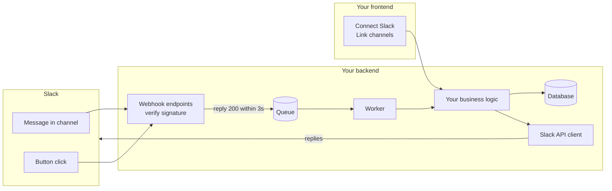
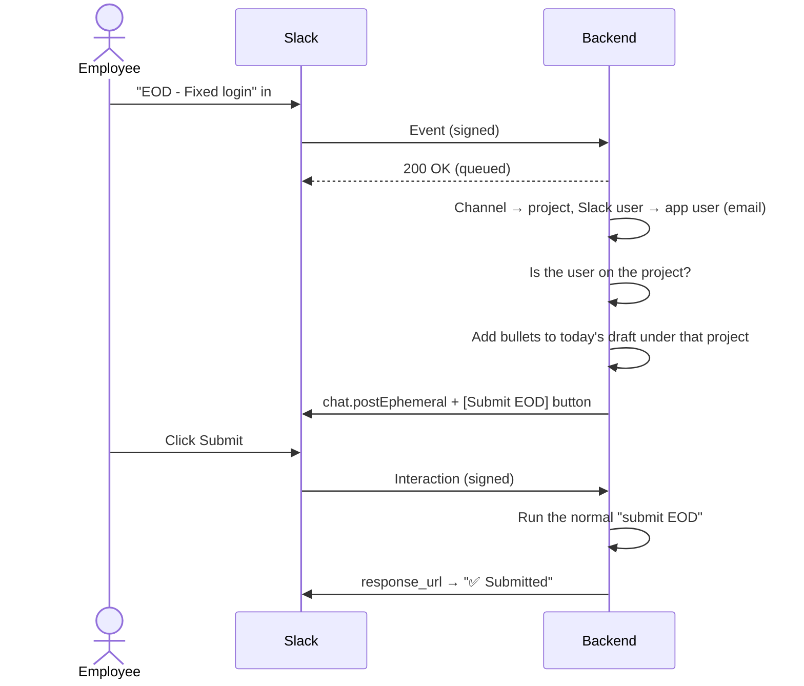

# Connect Slack to Your App

A step-by-step guide to connecting **any web app** to Slack, so your users can take actions in your app without leaving Slack.

It covers:
- what you need,
- how the connection works,
- how to set it up,
- the code you need on your backend,
- what you can build with it, using **"submit your daily report from Slack"** as a worked example.

The examples use Node.js / TypeScript, but the same steps work in any language.

---

## Table of contents
1. [What you can build](#1-what-you-can-build)
2. [How it works (in plain words)](#2-how-it-works-in-plain-words)
3. [What you need](#3-what-you-need)
4. [Step 1: Create a Slack app](#4-step-1-create-a-slack-app)
5. [Step 2: Make your backend reachable](#5-step-2-make-your-backend-reachable)
6. [Step 3: Configure the Slack app](#6-step-3-configure-the-slack-app)
7. [Step 4: Build the backend](#7-step-4-build-the-backend)
8. [Step 5: Build the frontend](#8-step-5-build-the-frontend)
9. [Example feature: submit a daily report (EOD) from Slack](#9-example-feature-submit-a-daily-report-eod-from-slack)
10. [Security checklist](#10-security-checklist)
11. [Troubleshooting](#11-troubleshooting)

---

## 1. What you can build

Once Slack is connected, your users can do things in your app **from inside Slack**. Some examples:

| Action in Slack | What happens in your app |
|---|---|
| Post a message in a linked channel | It's saved as a record: a daily report, a note, a ticket, a comment |
| Click a button on a bot message | Approve or reject a request, submit a form, mark a task done |
| Type a slash command (`/report`, `/leave`) | Open a form, show data, create something |
| Fill in a pop-up form (modal) | Create or update a record with structured fields |
| Get a private bot message | Reminders, confirmations, errors meant only for that person |
| Get a channel message | Notifications such as "New request submitted" or "Build finished" |

This guide builds one complete feature as the worked example: **employees post their End-of-Day (EOD) report in a Slack channel, and it's saved in the app under the right project** ([section 9](#9-example-feature-submit-a-daily-report-eod-from-slack)). Every other feature uses the same building blocks.

---

## 2. How it works (in plain words)

### Words you'll see

| Word | Simple meaning |
|---|---|
| **Workspace** | A company's whole Slack, for example "Acme Inc". |
| **Slack app / bot** | A robot user you create. It can read messages, reply and show buttons. |
| **OAuth ("Add to Slack")** | The "Allow this app?" screen. When a company clicks **Allow**, Slack gives your app a key for their workspace. |
| **Bot token** | That key (`xoxb-…`). Store it encrypted; never show it. |
| **Webhook** | A doorbell on your server. When something happens in Slack, Slack sends an HTTP request to a URL you choose. |
| **Signing Secret** | A password only Slack and you know. Slack signs every request with it, so you can prove it's really Slack. |
| **Event** | Something that happened in Slack: a message posted, edited or deleted, the app uninstalled. |
| **Interaction** | A user clicked a button or submitted a form on your bot's message. |
| **Ephemeral message** | A message only one person can see. Good for confirmations and errors. |

### The three ways Slack and your app talk

```
             ① OAuth: "Allow"  (once per company)
   Company ─────────────────────────────────────►  Your app gets a bot token
   Admin

             ② Your app → Slack  (Web API, using the bot token)
   Your app ─────────────────────────────────────►  Post messages, list channels, look up users

             ③ Slack → your app  (webhooks, signed with the Signing Secret)
   Slack    ─────────────────────────────────────►  "New message", "Button clicked"
```

1. **Connecting (OAuth).** A company admin clicks *Connect Slack* in your app, then *Allow* in Slack. Your app receives a **bot token** for that workspace and saves it.
2. **Your app calls Slack.** Using the token, your backend calls Slack's Web API to post replies, list channels and read user emails.
3. **Slack calls your app.** When something happens (a message, a button click), Slack sends a **signed** HTTP request to your webhook URL. Your backend checks the signature, answers fast, and does the work.

### Architecture



**Two golden rules:**
1. **Check the signature on every request from Slack.** Otherwise anyone could fake messages.
2. **Answer Slack within 3 seconds**, then do the work in the background (a queue). If you're slow, Slack retries and you may process the same thing twice.

---

## 3. What you need

| Requirement | Why |
|---|---|
| A Slack workspace where you can install apps | To create and test your app. Free is fine. |
| A backend with a **public HTTPS URL** | Slack must reach your server. For local development, use **ngrok**. |
| A database | To store each company's workspace, bot token and links |
| A background queue (recommended) | For example Redis + BullMQ, Sidekiq or Celery, to answer Slack fast and process later |
| Three keys from Slack | **Client ID**, **Client Secret**, **Signing Secret** (Step 1) |

---

## 4. Step 1: Create a Slack app

1. Go to **https://api.slack.com/apps** → **Create New App** → **From scratch**.
2. Give it a name (for example `YourApp`) and pick your workspace → **Create App**.
3. On **Basic Information → App Credentials**, copy the three keys into your backend's environment:

```env
SLACK_CLIENT_ID=1234567890.1234567890
SLACK_CLIENT_SECRET=xxxxxxxxxxxxxxxxxxxxxxxxxxxxxxxx
SLACK_SIGNING_SECRET=xxxxxxxxxxxxxxxxxxxxxxxxxxxxxxxx
BACKEND_BASE_URL=https://api.yourapp.com      # public URL, no trailing slash
FRONTEND_BASE_URL=https://app.yourapp.com     # where users return after connecting
```

| Key | Used for |
|---|---|
| Client ID | Building the "Connect Slack" link |
| Client Secret | Swapping the OAuth code for a bot token. Keep it private. |
| Signing Secret | Verifying that webhook requests really come from Slack |

> 💡 Create **two Slack apps**, one for development and one for production, so testing never touches real users.
> 🔒 Never commit these values. Restart your backend after changing them.

---

## 5. Step 2: Make your backend reachable

Slack lives on the internet, so it can't call `localhost`.

**Local development with ngrok:**
```bash
ngrok http 3000
# Forwarding  https://abcd-1234.ngrok-free.app -> http://localhost:3000
```
Put `https://abcd-1234.ngrok-free.app` in `BACKEND_BASE_URL` and restart the backend.

- The free ngrok address changes on every restart. Claim a free static domain in the ngrok dashboard to keep it fixed.
- Locally, point `FRONTEND_BASE_URL` at your local frontend, so users don't get sent to production after connecting.

**Production:** use your real API domain.

---

## 6. Step 3: Configure the Slack app

In **https://api.slack.com/apps** → your app. Replace `BACKEND_BASE_URL` with your URL.

> ⚠️ Most common mistake: a missing `/`.
> ✅ `https://api.yourapp.com/integrations/slack/events`
> ❌ `https://api.yourapp.comintegrations/slack/events`

### 6.1 Socket Mode → Off
**Settings → Socket Mode → Off.** This guide uses webhooks. With Socket Mode on, Slack hides the URL fields and never calls your server.

### 6.2 OAuth & Permissions
- **Redirect URL:** `BACKEND_BASE_URL/integrations/slack/oauth/callback` → **Save URLs**
- **Bot Token Scopes:** add only what your features need. Common ones:

| Scope | Allows the bot to | Needed for |
|---|---|---|
| `chat:write` | Send messages | Replies, notifications, buttons |
| `channels:read` / `groups:read` | List public / private channels | A "pick a channel" dropdown |
| `channels:history` / `groups:history` | Receive messages in public / private channels | Reading posts (such as daily reports) |
| `channels:join` | Join public channels | Joining automatically when a channel is linked |
| `users:read` + `users:read.email` | Look up users and their email | Matching Slack users to your app's users |
| `commands` | Slash commands | `/report`, `/leave`, … |
| `im:history`, `im:write` | Direct messages | Private chats with the bot |

### 6.3 Event Subscriptions (Slack → you)
1. **Enable Events → On**
2. **Request URL:** `BACKEND_BASE_URL/integrations/slack/events` → wait for **✅ Verified**
3. **Subscribe to bot events**, for example:
   - `message.channels`, `message.groups`: messages in channels
   - `app_uninstalled`, `tokens_revoked`: to clean up when a company removes the app
4. **Save Changes**

### 6.4 Interactivity (buttons and forms)
**Interactivity → On** → **Request URL:** `BACKEND_BASE_URL/integrations/slack/interactions` → **Save Changes**

### 6.5 Slash commands (optional)
**Slash Commands → Create New Command**, for example `/report` → Request URL `BACKEND_BASE_URL/integrations/slack/commands`.

### 6.6 Let other companies install it (production)
**Manage Distribution → Activate Public Distribution.**

> When Slack shows *"reinstall your app"* after you change scopes, reconnect from **your app's** Connect button (not Slack's page), so your backend saves the new token.

---

## 7. Step 4: Build the backend

### 7.1 Endpoints you need

| Endpoint | Called by | Purpose |
|---|---|---|
| `GET /integrations/slack/install-url` | Your frontend (logged in) | Returns the Slack "Allow" link |
| `GET /integrations/slack/oauth/callback` | Slack (browser redirect) | Swaps the code for a token, saves it, redirects back |
| `POST /integrations/slack/events` | Slack | Messages and other events |
| `POST /integrations/slack/interactions` | Slack | Button clicks and form submits |
| `GET /integrations/slack` | Your frontend | Connection status |
| `DELETE /integrations/slack` | Your frontend (admin) | Disconnect |
| Your feature endpoints | Your frontend | For example: list channels, link a channel to a record |

### 7.2 Database tables

```
slack_workspaces      company_id (unique), team_id (unique), team_name,
                      bot_token_encrypted, installed_by, created_at

slack_user_links      team_id + slack_user_id (unique) → user_id
                      (remembers who is who after the first email match)

+ tables for your features, for example:
slack_channel_links   channel_id (unique) → the record it belongs to (project, team…)
```

Use `ON DELETE CASCADE` so deleting a company or user also removes its Slack rows.

### 7.3 Connect a workspace (OAuth)

```ts
// 1) Build the "Allow" link. `state` is signed and expires, so nobody can forge it.
const SCOPES = ['chat:write', 'channels:read', 'channels:history', 'users:read', 'users:read.email'];

function installUrl(companyId: number, userId: number) {
  const state = signToken({ companyId, userId, returnTo: '/settings/integrations' }, { expiresInMinutes: 10 });
  const params = new URLSearchParams({
    client_id: env.SLACK_CLIENT_ID,
    scope: SCOPES.join(','),
    redirect_uri: `${env.BACKEND_BASE_URL}/integrations/slack/oauth/callback`,
    state,
  });
  return `https://slack.com/oauth/v2/authorize?${params}`;
}

// 2) Slack sends the browser back here after "Allow".
async function oauthCallback(code: string, state: string) {
  const install = verifyToken(state);                    // reject if forged or expired
  const res = await fetch('https://slack.com/api/oauth.v2.access', {
    method: 'POST',
    headers: { 'Content-Type': 'application/x-www-form-urlencoded' },
    body: new URLSearchParams({
      client_id: env.SLACK_CLIENT_ID,
      client_secret: env.SLACK_CLIENT_SECRET,
      code,
      redirect_uri: `${env.BACKEND_BASE_URL}/integrations/slack/oauth/callback`,
    }),
  }).then((r) => r.json());
  if (!res.ok) throw new Error(res.error);

  await db.slackWorkspaces.upsert({
    companyId: install.companyId,
    teamId: res.team.id,                                  // identifies the workspace in every event
    teamName: res.team.name,
    botTokenEncrypted: encrypt(res.access_token),         // never store it in plain text
  });
  return `${env.FRONTEND_BASE_URL}${install.returnTo}?slack=connected`;
}
```

### 7.4 Verify every request from Slack

```ts
import { createHmac, timingSafeEqual } from 'crypto';

function isFromSlack(rawBody: Buffer, timestamp: string, signature: string) {
  if (Math.abs(Date.now() / 1000 - Number(timestamp)) > 300) return false; // older than 5 min: reject (replay)
  const expected =
    'v0=' + createHmac('sha256', env.SLACK_SIGNING_SECRET)
      .update(`v0:${timestamp}:${rawBody.toString()}`)
      .digest('hex');
  const a = Buffer.from(expected);
  const b = Buffer.from(signature);
  return a.length === b.length && timingSafeEqual(a, b);
}
```
- Use the **raw** request body (the exact bytes), not the parsed JSON. Most frameworks need a setting to keep it.
- The headers are `X-Slack-Request-Timestamp` and `X-Slack-Signature`.
- Turn off rate limiting for these routes. Slack sends traffic for every company from the same IPs.

### 7.5 Receive events: answer fast, work later

```ts
app.post('/integrations/slack/events', verifySlackSignature, (req, res) => {
  const body = req.body;

  // Slack checks the URL once when you save it
  if (body.type === 'url_verification') return res.json({ challenge: body.challenge });

  // Queue it. Using event_id as the job ID makes Slack's retries harmless.
  queue.add('slack-event', body, { jobId: body.event_id });
  res.status(200).send();                                 // within 3 seconds
});

worker.process('slack-event', async ({ team_id, event }) => {
  if (event.bot_id) return;                               // ignore bots, including yourself
  const workspace = await db.slackWorkspaces.findByTeam(team_id);   // which company?
  if (!workspace) return;
  // ...your feature logic (see section 9)
});
```

### 7.6 Receive button clicks

Slack sends these as **form data** with a field named `payload` that holds JSON.

```ts
app.post('/integrations/slack/interactions', verifySlackSignature, (req, res) => {
  queue.add('slack-interaction', JSON.parse(req.body.payload));
  res.status(200).send();
});

worker.process('slack-interaction', async (payload) => {
  const action = payload.actions[0];                      // { action_id, value }
  // ...do the action, then update the message:
  await fetch(payload.response_url, {
    method: 'POST',
    headers: { 'Content-Type': 'application/json' },
    body: JSON.stringify({ replace_original: true, text: '✅ Done' }),
  });
});
```

### 7.7 Call Slack (Web API)

```ts
async function slack(token: string, method: string, args: Record<string, unknown>) {
  const form = new URLSearchParams();
  for (const [k, v] of Object.entries(args)) {
    if (v !== undefined) form.set(k, typeof v === 'string' ? v : JSON.stringify(v));
  }
  const res = await fetch(`https://slack.com/api/${method}`, {
    method: 'POST',
    headers: { Authorization: `Bearer ${token}`, 'Content-Type': 'application/x-www-form-urlencoded' },
    body: form,
  }).then((r) => r.json());
  if (!res.ok) throw new Error(`${method}: ${res.error}`);
  return res;
}

// Examples
await slack(token, 'chat.postEphemeral', { channel, user, text: 'Saved!' });
await slack(token, 'users.info', { user: slackUserId });   // → user.profile.email
await slack(token, 'conversations.list', { types: 'public_channel,private_channel' });
```

> ⚠️ **Send form data, not JSON.** Many Slack "read" methods (`conversations.info`, `users.info`, …) ignore a JSON body and answer `invalid_arguments`. Form data works for every method; put objects such as `blocks` in as a JSON string.

### 7.8 Match Slack users to your users

```ts
async function findAppUser(workspace, slackUserId) {
  const cached = await db.slackUserLinks.find(workspace.teamId, slackUserId);
  if (cached) return cached.userId;

  const { user } = await slack(decrypt(workspace.botTokenEncrypted), 'users.info', { user: slackUserId });
  const appUser = await db.users.findActiveByEmail(workspace.companyId, user.profile.email);
  if (appUser) await db.slackUserLinks.save(workspace.teamId, slackUserId, appUser.id);
  return appUser?.id ?? null;
}
```

### 7.9 Clean up on uninstall
Subscribe to `app_uninstalled` and `tokens_revoked`. When they arrive, delete that workspace's row and its links.

---

## 8. Step 5: Build the frontend

You need very little UI:

| Where | What |
|---|---|
| **Settings → Integrations** (admins) | A Slack card showing *Connect* or *Connected · Workspace name · Disconnect* |
| **Feature pages** (optional) | For example, a "Slack channel" dropdown on a project page |
| **Return from Slack** | Read `?slack=connected` / `?slack=error` from the URL and show a message |

```ts
// Connect button
const { url } = await api.get('/integrations/slack/install-url', { params: { returnTo: location.pathname } });
window.location.href = url;

// After returning
const result = new URLSearchParams(location.search).get('slack');
if (result === 'connected') toast.success('Slack connected');
```

Use the official multi-colour Slack logo (`#E01E5A`, `#36C5F0`, `#2EB67D`, `#ECB22E`) on a white tile, and follow Slack's brand guidelines.

---

## 9. Example feature: submit a daily report (EOD) from Slack

The building blocks above, used to build one real feature.

### What the user does
1. An admin links each **project** to a **Slack channel** (`#project-alpha` → Project Alpha).
2. An employee posts in that channel:
   ```
   EOD
   - Fixed the login bug
   - Reviewed the invoices PR
   ```
3. Only they see the bot's reply:
   > 📝 Saved to your EOD draft for **16 Oct** · **Project Alpha** — 2 bullets **[ Submit EOD ]**
4. They click **Submit EOD**, and the report is submitted in the app. Managers are notified as usual.

### How it's built



| Part | Building block used |
|---|---|
| Linking a project to a channel | `conversations.list` (dropdown), `conversations.join` (bot joins), a `slack_channel_links` table |
| Reading the post | Event `message.channels` / `message.groups` |
| Knowing the project | Channel ID → linked project |
| Knowing the user | Section 7.8 (email match) |
| Private confirmation | `chat.postEphemeral` with a button |
| Submitting | Interactivity + `response_url` |
| Edits and deletes | Events with subtype `message_changed` / `message_deleted`, plus a table that remembers which message added which bullets |

**Message rules used:**

| Rule | Why |
|---|---|
| The first line must be exactly `EOD` (optionally `EOD 2026-10-14`) | So normal chat like "EOD is due at 6pm" is ignored |
| Each following line is one bullet (`-`, `•`, `*`, `1.`) | Simple to write |
| Posts are saved as a **draft**; **Submit** is a button | Submitting locks the report and notifies managers, so it should be deliberate |
| A second post **adds**; **editing** replaces; **deleting** removes | Behaves the way people expect in Slack |
| Errors are sent privately ("not on this project", "already submitted") | Doesn't clutter the channel |

### Other actions you could add the same way

| Action | Slack feature | Example |
|---|---|---|
| Apply for leave | Slash command + modal | `/leave` opens a form with dates and a reason |
| Approve or reject requests | Buttons on a bot message | Managers approve leave or overtime from Slack |
| Daily reminders | Scheduled `chat.postMessage` | "Don't forget your EOD" at 6 pm |
| Start/stop a timer | Slash command | `/timer start Project Alpha` |
| Notifications | `chat.postMessage` to a channel | "New EOD submitted by Ali" |
| Quick status | Slash command | `/hours` shows today's tracked time privately |

---

## 10. Security checklist

- [ ] Verify the **signature** on every Slack request (section 7.4) and reject requests older than 5 minutes
- [ ] **Encrypt** bot tokens before saving them
- [ ] **Sign** the OAuth `state` and give it an expiry, so installs can't be forged
- [ ] Only redirect to **your own** pages after OAuth (no open redirects)
- [ ] Check **permissions**: who may connect, disconnect and link
- [ ] Check the **user may act** on the record (for example, is a member of the project)
- [ ] Never log tokens, secrets or full request bodies
- [ ] Ask for the **fewest scopes** you need
- [ ] Clean up on `app_uninstalled` / `tokens_revoked`

---

## 11. Troubleshooting

| Problem | Likely cause | Fix |
|---|---|---|
| No "Request URL" field in Slack | Socket Mode is on | Settings → Socket Mode → Off |
| "Your URL didn't respond" | Wrong URL (often a missing `/`), backend down, ngrok stopped | Check the exact URL; backend running with the Signing Secret; ngrok running |
| Signature check always fails | Using the parsed body instead of the raw body, or the wrong secret | Keep the raw body; use the **Signing Secret**, not the Client Secret |
| `invalid_arguments` from Slack | JSON body sent to a read method | Send form data (section 7.7) |
| Posted a message, nothing happened | Events not saved, Socket Mode on, or not reconnected after a settings change | Save Events; Socket Mode off; Disconnect → Connect in your app |
| Old messages never arrive | Slack doesn't resend history | Test with a new message after setup |
| Private channel missing | Bots can't see private channels uninvited | `/invite @YourBot` in that channel |
| Wrong site after "Allow" | `FRONTEND_BASE_URL` points to production | Use your local frontend address while testing |
| Same thing processed twice | Slack retried a slow response | Answer within 3 s; deduplicate by `event_id` |
| Everything broke after rotating a secret | Stored tokens were encrypted with the old key | Reconnect each workspace |
| ngrok URL changed | Free addresses change on restart | Update `.env` and the 3 Slack URLs, or use a static domain |

---

**Useful links:**
[Slack API docs](https://api.slack.com/docs) ·
[OAuth v2](https://api.slack.com/authentication/oauth-v2) ·
[Events API](https://api.slack.com/apis/connections/events-api) ·
[Interactivity](https://api.slack.com/interactivity) ·
[Verifying requests](https://api.slack.com/authentication/verifying-requests-from-slack) ·
[Block Kit Builder](https://app.slack.com/block-kit-builder)
